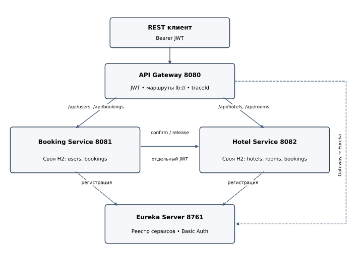

# REST API бронирования отелей

Учебный проект по Spring Boot: четыре самостоятельных приложения, собственные H2 у двух предметных сервисов и двухшаговое бронирование с компенсацией. Java 17, Spring Boot 3.5.15, Spring Cloud 2025.0.3. Версии зафиксированы в родительском `pom.xml`.

## Состояние проверки

Реализация, JUnit-тесты, сценарий HTTP-проверки и конфигурация CI находятся в проекте. 08.11.2026 повторный запуск оставил шесть файлов Surefire: 62 теста без ошибок и пропусков. Сквозной прогон через Gateway с `--faults` записал 25 успешных проверок; по журналам Booking и Hotel прослежены отмена брони и завершение компенсации. Вывод команды Maven и GitHub Actions пока не сохранены; повторный прогон в CI ещё не подтверждён.

## Состав

| Модуль | Назначение | Порт |
| --- | --- | --- |
| [discovery-server](discovery-server/README.md) | Eureka и регистрация сервисов | 8761 |
| [api-gateway](api-gateway/README.md) | Маршрутизация, JWT, traceId | 8080 |
| [booking-service](booking-service/README.md) | Пользователи, JWT, бронирования, координатор саги | 8081 |
| [hotel-service](hotel-service/README.md) | Каталог, занятость, блокировки и статистика | 8082 |
| [shared](shared/README.md) | DTO, интервалы дат, проверка JWT и общие ошибки | библиотека |



Booking и Hotel не читают чужие базы. Hotel хранит локальную проекцию занятости в своей таблице `bookings`. Сведения о пользователе и итоговом статусе остаются в Booking.

## Быстрый запуск в Docker

Нужны Docker Engine с Compose v2, доступ к Maven Central и реестру образов. В Windows запустите Docker Desktop с Linux containers. Ничего устанавливать в WSL вручную не требуется.

```powershell
docker compose up -d --build --wait
python scripts/e2e.py
docker compose logs -f booking-service hotel-service
```

Проверка сетевого сбоя с временной приостановкой Hotel, сохраняющей его H2:

```powershell
python scripts/e2e.py --faults
```

Скрипт `--faults` работает со стеком Compose этого проекта. Для обычной проверки другого стенда этот флаг не нужен. Повторный запуск создаёт отдельный тестовый отель. Полный сброс демонстрационных данных:

```powershell
docker compose down
docker compose up -d --wait
```

H2 работает в памяти. Перезапуск отдельного предметного сервиса уничтожает его данные и нарушает соответствие проекций другого сервиса. В учебном стенде после такого перезапуска следует сбрасывать оба предметных сервиса. В испытании отказа используется `pause/unpause`, а не уничтожение контейнера.

## Локальный запуск без Docker

Нужен JDK 17+ и доступ к Maven Central. Скрипты загружают Maven 3.9.9 в `.tools` и проверяют SHA-512 архива; системные настройки не меняются. Если Maven уже установлен, можно везде использовать `mvn`.

```powershell
./mvnw.cmd -B verify
powershell -NoProfile -ExecutionPolicy Bypass -File scripts/start.ps1
python scripts/e2e.py
powershell -NoProfile -ExecutionPolicy Bypass -File scripts/stop.ps1
```

`start.ps1` сначала выполняет сборку с тестами. Он записывает PID и время запуска, а `stop.ps1` останавливает только совпадающие Java-процессы. Если исполнение `.ps1` разрешено, достаточно `./scripts/start.ps1`. Параметр `ExecutionPolicy` действует на один процесс.

Linux/macOS:

```bash
sh mvnw -B verify
java -jar discovery-server/target/discovery-server-1.0.0.jar
# В трёх других терминалах:
java -jar hotel-service/target/hotel-service-1.0.0.jar
java -jar booking-service/target/booking-service-1.0.0.jar
java -jar api-gateway/target/api-gateway-1.0.0.jar
```

Первые запросы выполняйте после регистрации сервисов в Eureka. Скрипт `e2e.py` ждёт готовности до 90 секунд.

## Демонстрационные учётные записи

| Пользователь | Пароль | Роль |
| --- | --- | --- |
| admin | DemoAdmin123! | ADMIN |
| student | DemoUser123! | USER |
| student2 | DemoUser123! | USER |

Есть два отеля, пять работающих номеров и один номер на ремонте. Исходные счётчики равны нулю, занятость формируется реальными бронированиями. Данные отключаются через `SEED_DATA=false`. Пароли задаются переменными `BOOTSTRAP_ADMIN_PASSWORD`, `BOOTSTRAP_USER_PASSWORD`.

Ключи с префиксом `demo-` и эти пароли предназначены для локального учебного стенда. При ином размещении нужны свои RSA-ключи, пароли и HTTPS. Закрытые ключи включены только в Booking; Hotel и Gateway получают открытые ключи из `shared`. Настройки: `USER_PUBLIC_KEY`, `USER_PRIVATE_KEY`, `INTERNAL_PUBLIC_KEY`, `INTERNAL_PRIVATE_KEY` принимают Spring Resource URI, например `file:/run/keys/user-public.pem`.

## Первый запрос

```powershell
$credentials = @{username='student'; password='DemoUser123!'} | ConvertTo-Json
$auth = Invoke-RestMethod http://localhost:8080/api/users/auth -Method Post -ContentType application/json -Body $credentials
$headers = @{Authorization="Bearer $($auth.accessToken)"}
$start = (Get-Date).AddDays(10).ToString('yyyy-MM-dd')
$end = (Get-Date).AddDays(12).ToString('yyyy-MM-dd')
Invoke-RestMethod "http://localhost:8080/api/rooms/recommend?hotelId=1&startDate=$start&endDate=$end" -Headers $headers
$body = @{requestId=[guid]::NewGuid().ToString(); autoSelect=$true; hotelId=1; startDate=$start; endDate=$end} | ConvertTo-Json
Invoke-RestMethod http://localhost:8080/api/bookings -Method Post -Headers $headers -ContentType application/json -Body $body
Invoke-RestMethod http://localhost:8080/api/bookings -Headers $headers
```

Тот же `requestId` с тем же телом возвращает существующую бронь. Для нового бронирования нужен новый UUID. При `autoSelect=true` `roomId` не участвует в выборе; при ручном выборе `hotelId` не ограничивает номер, идентификатор номера уникален во всей системе.

## API и документация

Единая внешняя схема путей: `/api/users`, `/api/bookings`, `/api/hotels`, `/api/rooms`. Отличия от примерных путей из ТЗ описаны в [ADR 4](docs/adr/004-api.md).

| Запрос | Назначение | Доступ |
| --- | --- | --- |
| POST /api/users/register, /api/users/auth | Регистрация и вход | открытый |
| GET, POST /api/users | Список и создание пользователей | ADMIN |
| GET, PATCH, DELETE /api/users/{id} | Работа с пользователем | ADMIN |
| POST /api/bookings | Бронирование | USER, ADMIN |
| GET /api/bookings | Личная история с пагинацией | USER, ADMIN |
| GET, DELETE /api/bookings/{id} | Своя бронь, отмена | USER, ADMIN |
| GET, POST /api/hotels | Каталог и создание отеля | чтение USER/ADMIN; запись ADMIN |
| GET, PUT, DELETE /api/hotels/{id} | Отель | чтение USER/ADMIN; запись ADMIN |
| GET /api/hotels/{id}/occupancy | Статистика за период | ADMIN |
| GET, POST /api/rooms | Свободные номера, создание | чтение USER/ADMIN; запись ADMIN |
| GET /api/rooms/recommend | Рекомендации по счётчику | USER, ADMIN |
| GET, PUT, DELETE /api/rooms/{id} | Номер | чтение USER/ADMIN; запись ADMIN |

Внутренние `POST /api/rooms/{id}/confirm-availability` и `/release` доступны только с отдельным служебным JWT напрямую в Hotel. Gateway отклоняет оба маршрута. Пользовательский JWT не подходит для них.

Swagger UI: [Booking](http://localhost:8081/swagger-ui/index.html), [Hotel](http://localhost:8082/swagger-ui/index.html). OpenAPI через Gateway: [Booking](http://localhost:8080/docs/booking), [Hotel](http://localhost:8080/docs/hotel). [Eureka](http://localhost:8761) использует Basic Auth `registry / RegistryDemo123`. Порты в Compose опубликованы только на localhost.

Полные параметры, тела и ошибки: [API](docs/api.md). Обоснование решений: [ADR](docs/adr/001-saga.md). Схема данных: [базы данных](docs/database.md). Описание каждого модуля находится в его README.

## Тестирование и стиль

```powershell
./mvnw.cmd -B verify
./mvnw.cmd -B spotless:apply
powershell -NoProfile -ExecutionPolicy Bypass -File scripts/local-checks.ps1
```

`verify` запускает JUnit, MockMvc, WebTestClient, реальные транзакции H2 и HTTP-заглушку для Retry/Timeout/CircuitBreaker. Docker для JUnit не нужен. `local-checks.ps1` проверяет только независимое ядро и синтаксис Java. XML Surefire сохраняются в `*/target/surefire-reports`, HTTP-протокол - в `evidence/runtime/e2e.json`, журналы - в `evidence/runtime/services.log`; эти каталоги исключены из Git. Текущий HTTP-протокол относится к запуску с `--faults`. CI после JUnit должен повторить полный сценарий.

## Публикация на GitHub

Удалённый репозиторий уже создан: [Spring_session](https://github.com/AmsterdaM1505/Spring_session). Если `git remote -v` не показывает `origin`, добавьте его, затем отправьте проект:

```powershell
git remote add origin https://github.com/AmsterdaM1505/Spring_session.git
git branch -M main
git add .
git commit -m "Implement hotel booking microservices"
git push -u origin main
gh run list
```

Если `origin` уже настроен, пропустите команду `git remote add origin`. Если начальный коммит уже существует, второй коммит не нужен. Для доступа ментора добавьте его как collaborator либо самостоятельно измените видимость. Перед сдачей проверьте успешный workflow и результаты Surefire.
