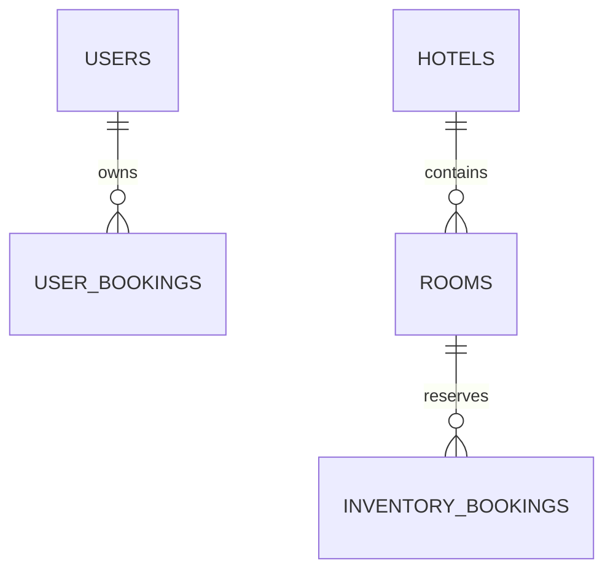

# Базы данных

Оба предметных сервиса используют разные in-memory H2. DDL создаётся Hibernate при запуске (`ddl-auto=create-drop`); SQL ниже - описание модели, а не дополнительный исполняемый init-скрипт. Для идентификаторов отелей, номеров и пользователей используется BIGINT IDENTITY, для брони - UUID. Время событий - UTC, даты проживания - DATE.

## Booking

| Таблица | Поля | Ограничения |
| --- | --- | --- |
| users | id, username, password, role, active, version | PK id; UNIQUE username; обязательные username, password, role, active |
| bookings | id, user_id, request_id, fingerprint, room_id, start_date, end_date, status, created_at, updated_at, release_required, failure_code, version | PK id; FK user_id → users.id; UNIQUE(user_id,request_id); room_id допускает NULL до выбора |

Пароль - BCrypt, поле длиной 100. Роль хранится строкой USER/ADMIN. Статус брони - PENDING/CONFIRMED/CANCELLED. fingerprint содержит нормализованные значимые параметры, не пароль и не JWT. JWT в базе не хранится.

Индекс `idx_booking_owner_date(user_id,created_at)` поддерживает личную историю. `idx_booking_recovery(status,release_required,created_at)` используется для поиска незавершённых операций; запрос с OR может не полностью использовать индекс, поэтому для большой постоянной базы следует разделить выборки. version - оптимистическая версия Hibernate. Изменения состояния выполняются с блокировкой строки брони. Создание сериализуется короткой блокировкой владельца: проверка requestId и вставка проходят вместе, вне сетевого вызова.

## Hotel

| Таблица | Поля | Ограничения |
| --- | --- | --- |
| hotels | id, name, address, version | PK id; name ≤120; address ≤250 |
| rooms | id, hotel_id, number, available, times_booked, version | PK id; FK hotel_id → hotels.id; UNIQUE(hotel_id,number) |
| bookings | booking_id, request_id, room_id, start_date, end_date, state, updated_at, version | PK booking_id; FK room_id → rooms.id; state HELD/RELEASED |

`idx_room_load(times_booked,id)` соответствует порядку рекомендаций. Текущая реализация получает свободные номера запросом и сортирует DTO в памяти; индекс оставлен для последующего переноса сортировки в SQL. `idx_slot_overlap(room_id,state,start_date,end_date)` сокращает область поиска занятости. SQL-ограничение исключения диапазонов не применяется: корректность пересечений обеспечивается транзакционной блокировкой rooms по PK и повторной проверкой слотов.

rooms.available - эксплуатационное состояние. times_booked - неотрицательное историческое число успешных выделений, изменяется только сервисным методом. RELEASED сохраняется как запрет запоздалого confirm. Модель не имеет общей межбазовой FK: room_id в Booking - внешний идентификатор, его доступность проверяется HTTP-вызовом.

USER_BOOKINGS и INVENTORY_BOOKINGS - подписи на схеме; обе реальные таблицы называются bookings, но расположены в разных H2. Логическая связь их UUID не является внешним ключом. Физическое удаление номеров с историей запрещено; деактивация пользователя сохраняет его FK.
